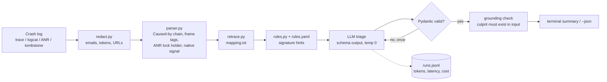

# crash-triager

Paste an Android crash log, get the likely root cause, the culprit frame, a severity, and a concrete fix, as schema-validated JSON.

It is a hybrid. A deterministic parser and signature rules do the cheap, testable work: extract the crash from logcat noise, walk the `Caused by` chain, tag app vs framework frames, retrace R8 output, find the lock holder in an ANR, and redact secrets. One LLM call does the reasoning on that cleaned input, and the answer is validated, repaired once if needed, and checked against the input so it cannot cite frames that are not there.

```
$ triage crash.txt --package com.example.app
P1  lifecycle_state  (high confidence)  java.lang.IllegalStateException

Root cause  A dialog is shown from a coroutine callback after onSaveInstanceState...
Culprit     com.example.app.cart.CartFragment.showCouponDialog  CartFragment.kt:88
Severity    Inferred from the trace alone: cart is a core flow.

Fix  Collect with repeatOnLifecycle(STARTED) so the dialog is only shown while started.
  1. ...
```
*(Output shape shown; text varies by model. Demo GIF: [add after first real run].)*

## Architecture



| File | Job |
| --- | --- |
| `triager/parser.py` | Logcat extraction, exception chain, frame tagging (app / androidx / framework / sdk), ANR thread dumps, tombstones, obfuscation detection |
| `triager/retrace.py` | Minimal R8 retrace: class, method, line ranges |
| `triager/redact.py` | PII and secret scrubbing that keeps pc values, lock ids and line numbers intact |
| `triager/rules.yaml` | 27 known Android crash signatures, used as hints, never as final answers |
| `triager/schema.py` | Pydantic models; the strict JSON schema sent to the model is derived from them |
| `triager/prompts.py` | System prompt with severity rubric and two worked examples; `PROMPT_VERSION` is logged on every call |
| `triager/llm_client.py` | Stdlib-only client for OpenAI-compatible APIs (Gemini, Groq, OpenRouter, OpenAI, Ollama) and Anthropic; backoff with full jitter; streaming |
| `triager/pipeline.py` | Four modes, repair retry, grounding check, cost logging |
| `eval/` | Runs the golden set through each mode and grades it |
| `golden/` | 30 labelled crashes plus one R8 mapping file |
| `repro-app/` | Android app that triggers 15 crash families on purpose, for real captures |

## Quick start

```bash
python -m venv .venv && source .venv/bin/activate
pip install -e ".[dev]"
pytest                                   # 49 tests, no network, no key

# No key needed:
triage golden/crashes/c25_anr_lock_contention.txt --mode rules_only --package com.example.triagedemo
triage golden/crashes/c08_network_on_main_login.txt --dry-run      # exactly what would be sent

# With a free Gemini key (https://aistudio.google.com):
export GEMINI_API_KEY=...
triage golden/crashes/c01_fragment_state_loss.txt --package com.example.triagedemo --stream
adb logcat -d -b crash | triage - --package com.example.app
```

Providers: `--provider gemini|groq|openrouter|openai|ollama|anthropic`, model via `--model` or `TRIAGER_MODEL`. Presets live in `triager/llm_client.py`. Check your provider's model list; names change.

Useful flags: `--mapping mapping.txt` (retrace), `--crash-count`, `--affected-users`, `--on-startup` (real impact overrides inferred severity), `--json`, `--dry-run`.

## Evaluation

Four modes on the same crashes isolate what each layer adds:

| Mode | What the model gets |
| --- | --- |
| `rules_only` | No model. Parser + rules + a severity heuristic. Free, deterministic floor. |
| `baseline` | Raw log + "What caused this Android crash?" (schema enforced so it can be auto-graded) |
| `llm_only` | Full system prompt + schema, raw log, no parser, rules or retrace |
| `full` | Everything above, plus grounding check |

```bash
python -m eval.run_eval --modes rules_only
python -m eval.run_eval --modes baseline,llm_only,full --sleep 4   # free-tier friendly, resumable
python -m eval.grade eval/out/offline eval/out/<your-run>
```

The grader writes `results.md`, `results.json`, and `fix_grades.csv`. Fill the `grade` column (0 = wrong/generic, 1 = right direction, 2 = actionable) and re-run to get fix usefulness.

### Results

**Dev split, rules_only** (measured, 2026-11-05):

| Metric | rules_only |
| --- | --- |
| Root-cause category accuracy | 100% (30/30) |
| Culprit frame accuracy | 100% (25/25) |
| Severity exact / within one | 60% / 100% |

**Do not quote these.** The rules were written alongside these 30 crashes, so they are tuned to them; the number shows the plumbing works, not that the rules generalise. Honest numbers need the `test` split: crashes captured from `repro-app/` or public issue trackers after `rules.yaml` and the prompt are frozen.

**LLM modes:** [measured] once run with your key. Fill this table from `results.md`:

| Metric (test split) | rules_only | baseline | llm_only | full |
| --- | --- | --- | --- | --- |
| Category accuracy | [measured] | [measured] | [measured] | [measured] |
| Culprit frame accuracy | [measured] | [measured] | [measured] | [measured] |
| Severity within one | [measured] | [measured] | [measured] | [measured] |
| Fix usefulness (0-2) | [measured] | [measured] | [measured] | [measured] |
| Schema valid first try | n/a | [measured] | [measured] | [measured] |
| p50 latency | n/a | [measured] s | [measured] s | [measured] s |
| Cost per crash | $0 | $[measured] | $[measured] | $[measured] |

## About the golden set

30 crashes across 15 categories: lifecycle, null safety, main-thread violations, coroutines, memory, Parcel/Binder, windows, Compose, permissions, Room, resources, ANRs (lock contention, broadcast, binder), R8 (obfuscated + mapping, reflection keep rule), and a native SIGSEGV.

They are **synthetic**: hand-written to mirror real logcat, traces.txt and tombstone formats, with realistic framework frames. Several are deliberately hard:

* `c02` is an NPE whose real cause is collecting in `lifecycleScope` instead of `viewLifecycleOwner.lifecycleScope`.
* `c11`, `c15`, `c19` have no responsible app frame; the right `culprit_frame` is `null`.
* `c14` is an OOM on a 16-byte allocation; the top frame is innocent and the right answer asks for a heap dump.
* `c09` is a StrictMode report, not a crash (P3).
* `c03` and `c18` carry impact data that should override the trace-based severity.
* `c28` is obfuscated; only `full` and `rules_only` get the mapping.

Labels live in `golden/labels.jsonl` (category, accepted culprit frames, severity, expected fix, split).

## What failed and what I changed

Found while building, each now covered by a test:

1. **StrictMode reports were classified as `unknown`.** Kind detection ran on raw logcat lines, so `^\s*at ` never matched behind the timestamp prefix. Detection now runs on prefix-stripped text, and the parser builds an exception link from the `StrictMode policy violation; ...: <Type>` line.
2. **Redaction was destroying native crashes.** A pattern for 16-hex device IDs also matched every `pc` value and register in tombstones. Now device IDs are only redacted when labelled (`android_id=`, `device_id:`).
3. **Retrace could rewrite ordinary words.** Substituting obfuscated class names in exception messages would have replaced every bare `a`. Only dotted names are substituted now.
4. **Rules-only scored 100% on its own dev set.** That is leakage, not accuracy. Added the `dev`/`test` split, and the grader stamps a warning on dev-only results.
5. [Add failures from your first LLM run here: e.g. cases where `llm_only` blamed the top frame, or where the repair retry fired.]

## Design decisions (interview notes)

* **Parser before LLM.** Cheaper, testable, and it removes the noise models misread (logcat chatter, wrappers). The `llm_only` vs `full` comparison measures this.
* **Native structured output, not prompted JSON.** `json_schema` (OpenAI-compatible) or a forced tool call (Anthropic). Falls back to JSON mode plus schema-in-prompt only when a provider rejects it, and logs that it did.
* **One repair retry.** Validation errors are fed back once; a second failure is reported, not hidden.
* **Grounding check in code.** The prompt says "never invent frames"; `grounding_check` enforces it and downgrades confidence.
* **Severity needs impact.** From a trace alone severity is a guess, and the output says so. Crashlytics counts override it.
* **Temperature 0 and a logged `PROMPT_VERSION`** so every eval number traces to an exact prompt.
* **Stdlib HTTP client.** Every byte on the wire is visible, which makes retries, streaming and token accounting easy to explain.
* **Prices left blank.** `pricing.yaml` is empty on purpose; cost shows as `n/a` until real prices are entered, so unknown never masquerades as $0.

## Next steps

* Capture 15+ held-out crashes from `repro-app/` and run all four modes on the `test` split.
* Cheap vs strong model on `full` (reuse the ModelHarness).
* Replace hand-graded fix usefulness with an LLM-as-judge and report its agreement with my grades (project 10).
* An MCP server over Crashlytics so impact data arrives automatically (project 8).
